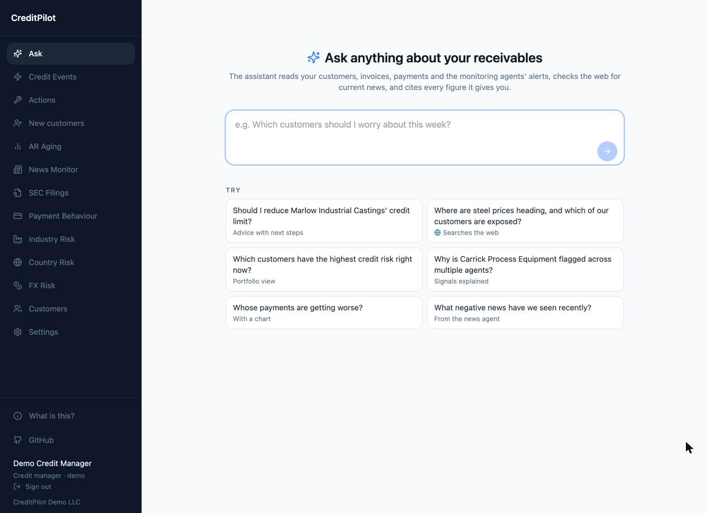
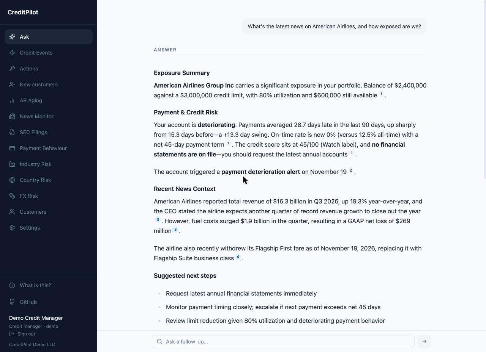
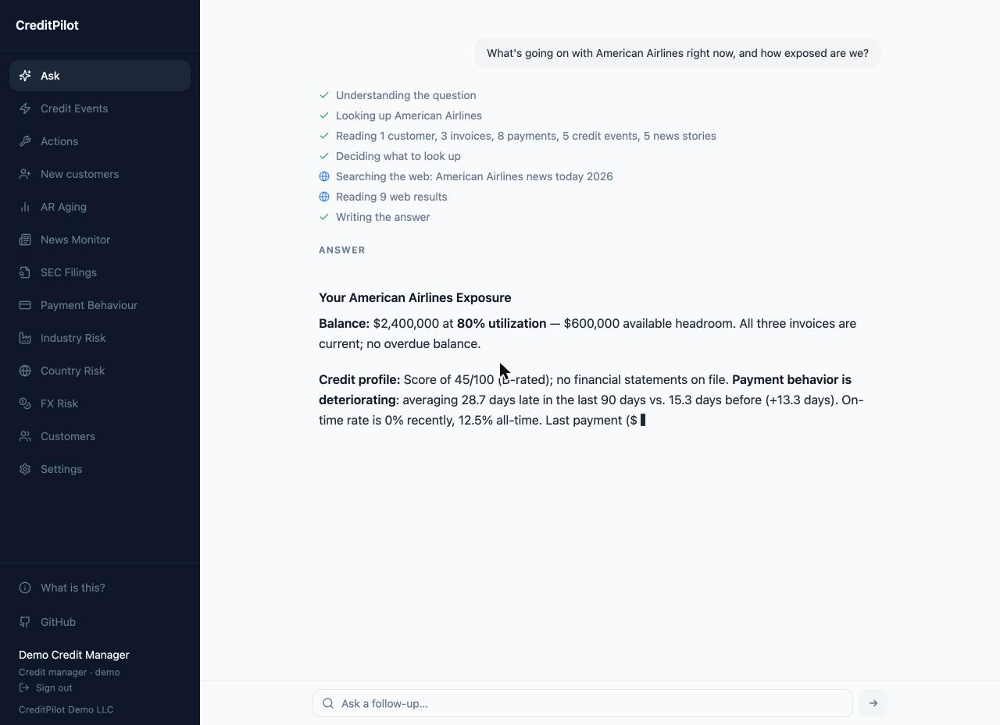
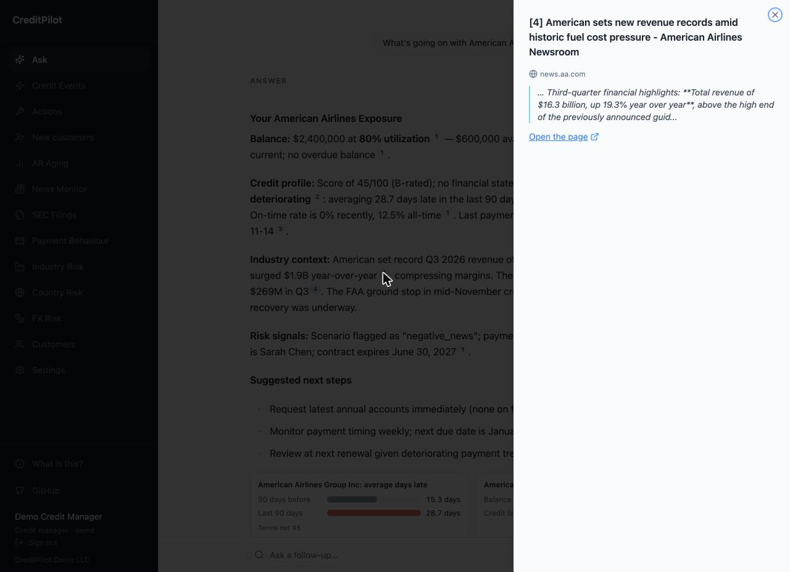

# CreditPilot

**Perplexity for trade credit.** Ask anything about your receivables in plain English. The assistant reads your customers, invoices, payments and the alerts its monitoring agents raise, checks the web for current news, and cites every figure it gives you. Agents can propose actions, such as a lower credit limit, but nothing changes until a person approves it.

Open source (MIT). **Live demo: [creditpilot.vercel.app](https://creditpilot.vercel.app)**, no sign-up needed.



---

## What the assistant (CIA) does

| | |
|---|---|
| **Answers from your data, with sources** | Every claim carries a numbered citation. Click it to see the record behind it: an invoice, a payment, an agent's alert. |
| **Reads the web too** | For a question about a customer, a sector or "what's happening", it searches the web and puts the news next to your exposure. Web facts are cited to their pages. Figures about your own customers only ever come from your data. |
| **Shows its work** | You see each step as it happens ("Reading 1 customer, 8 payments, 5 credit events…", "Searching the web: …"), then the answer as it is written. |
| **Never does the arithmetic itself** | Totals, aging buckets, payment trends, limit use and every chart are computed in code and handed to the model as facts. The model explains numbers; it does not produce them. |
| **Ends advice with next steps** | "Should I reduce Arconic's limit?" gets the facts, then 2–3 steps you can take, in CreditPilot first. Missing or out-of-date accounts become "ask for the latest annual accounts". |
| **Lets you act from the answer** | Open the customer, or approve or reject the action an agent proposed, right under the answer. |
| **Keeps the conversation** | Follow-ups stack on the page and keep the context, so "is that more than their limit?" knows who "their" is. |
| **Shares an answer** | One link opens the question, the answer, its sources and charts. |



<details>
<summary>More screenshots: the steps while it works, and a web source opened</summary>




</details>

### Try these in the demo

- Should I reduce Arconic's credit limit?
- What's the latest news on American Airlines, and how exposed are we?
- Which customers have the highest credit risk right now?
- Whose payments are getting worse?

The demo runs on a sample portfolio: real company names used for illustration, with every score, invoice, payment, event and news item invented. It replays the same story each day with today's dates. Answers are written live by Claude (10 questions per visitor per day).

---

## How it works

```
DATA IN            customers, AR aging (CSV from any ERP), payments, news, SEC filings,
                   sector and country data, FX rates, credit scores
     │
MONITORING AGENTS  each writes what it finds to one shared event log (credit_events)
                   AR aging · news · SEC filings · payment behaviour · industry ·
                   country · FX · credit score · sanctions
     │
CIA                reads the log and the data, answers questions with citations,
                   flags customers several agents agree on
     │
PEOPLE             approve or reject proposed actions (Actions page); nothing changes
                   without sign-off, and every decision is kept in an audit trail
```

| Agent | What it watches |
|---|---|
| AR aging | Overdue invoices and how much of each limit is used |
| News monitor | Negative news per customer, classified by severity |
| SEC monitor | Filings with distress signals (EDGAR, no key needed) |
| Payment behaviour | Customers paying later (or earlier) than they used to |
| Industry risk | Sector downturns and disruptions (FRED economic data, GDELT news) |
| Country risk | Country ratings and policy changes for where customers sit |
| FX risk | Open receivables in currencies that moved against you |
| Credit score | Score changes from the provider you choose |
| Sanctions | Customers and their owners against sanctions lists |
| CIA | Answers, daily briefing, multi-signal convergence |

New-customer onboarding (register checks via [Company Lookup](https://github.com/larsewallin/company-lookup), sanctions screening, the credit provider's report and a proposed limit for approval) is in the code and works on your own install; it is switched off in the public demo.

More detail: [docs/AGENTS.md](docs/AGENTS.md) and [docs/ARCHITECTURE.md](docs/ARCHITECTURE.md).

---

## Run it yourself

The demo on your own computer, with one command (needs Docker and Node.js):

```bash
git clone https://github.com/larsewallin/creditpilot.git
cd creditpilot
scripts/setup-local.sh
```

It starts a local Supabase stack, applies the schema, loads the demo data and prints sign-in accounts. Then run `npx supabase@3.1.0 functions serve --env-file supabase/functions/.env.local` and `npm run dev`, and open http://localhost:5173.

For a real install on your own Supabase project (your data, `DEMO_MODE=false`, agent schedules, score sources), follow **[docs/RUN_IT_YOURSELF.md](docs/RUN_IT_YOURSELF.md)**.

---

## Your data

CreditPilot is built to run on your own infrastructure: your Supabase project (or Postgres) holds every customer, invoice and event. Vercel only serves the compiled frontend.

The only outside AI calls go to the Anthropic API:

| Feature | What is sent |
|---|---|
| CIA answers | The question, plus the records relevant to it: customer names, limits, balances, scores, invoices and payments when the question needs them, and the agents' alerts. No database IDs. |
| CIA web research | Search queries the model writes (they can include a customer's name), run by Anthropic's web search tool. Switch off with `CIA_WEB_SEARCH=off`. |
| News monitor | Public headlines and summaries, for classification. |

Anthropic does not train on API data by default ([privacy policy](https://www.anthropic.com/privacy)). The model calls sit in a few files (`supabase/functions/cia-agent`, `_shared/claude_stream.ts`, the generative skills), so a local model can replace them.

Security: every table has row-level security with restrictive policies; signed-out visitors can read only when an instance is explicitly a public demo; writes go through edge functions that check the caller's role; `tests/security/check-public-access.sh` runs in CI against a fresh install.

---

## Tech stack

| Layer | Technology |
|---|---|
| Frontend | React 18, Vite, TypeScript, Tailwind CSS, shadcn/ui, TanStack Query |
| Backend | Supabase Edge Functions (Deno, TypeScript) |
| Database | Supabase Postgres |
| AI | Anthropic Claude (Haiku in the demo, Sonnet for production answers), with web search |
| Hosting | Vercel (frontend), Supabase (database and functions) |

```
src/                     React app (pages/, components/cia/ for the assistant)
supabase/functions/      one folder per agent and endpoint; _shared/ for skills and helpers
supabase/migrations/     the schema, one dated migration per change (each with a rollback)
tests/                   CIA harness and eval, onboarding golden cases, security check
docs/                    architecture, agents, deployment, run-it-yourself
```

---

## How it is tested

- **375 unit tests** (Vitest) across the skills, the CIA's helpers and the app, plus a Deno type check of every edge function.
- **CIA eval**: 45 questions whose answers are checked against the database (totals, lists, payment trends, advice, follow-ups, web sources), run daily and on every change to the assistant.
- **CIA harness**: questions every pull request must pass against the live assistant.
- **Onboarding golden cases**: 14 applications with known outcomes.
- **Fresh install**: CI builds the whole stack from scratch in Docker and checks that a signed-out visitor can read nothing.
- Every merge to `main` deploys automatically (functions, migrations after a dry run, frontend) and checks the live app afterwards.

---

## Built with Claude Code

Most of this code was written with [Claude Code](https://claude.com/claude-code), and Claude powers the assistant in the app. [CLAUDE.md](CLAUDE.md) holds the engineering rules learned along the way, for example: never let a language model add up numbers across records.

## Contributing

See [CONTRIBUTING.md](CONTRIBUTING.md) for development setup, how to add an agent and the pull-request checklist.

## License

MIT: use it, fork it, build on it.

## About

I have spent the last two decades in trade and receivables finance. By day I work in trade credit insurance at Coface and at night I take a stab at this project to try and push the limits on what's possible to build. I'm not married to a specific model, but this project has been built mainly using Claude Code.

Follow along as new agents ship, or reach out if trade credit insurance is relevant to your business.

Let's connect! [Connect on LinkedIn](https://www.linkedin.com/in/larsewallin/)
